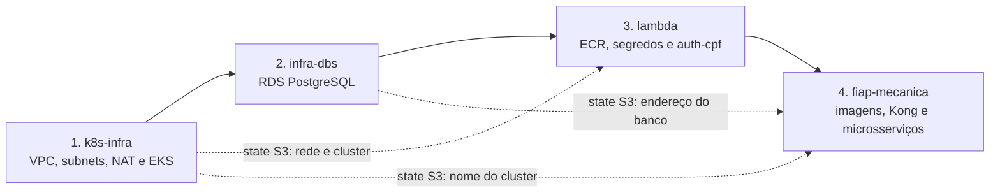
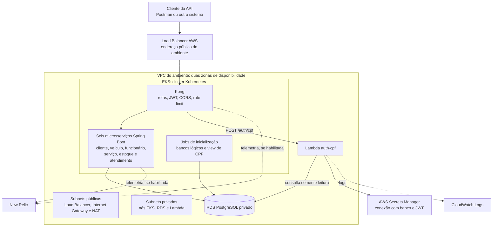

# Arquitetura geral e fluxo de deploy

Este guia explica como os quatro repositórios da Oficina Mecânica se conectam, o papel de cada tecnologia e o caminho do desenvolvimento local até homologação e produção. Os diagramas representam a arquitetura definida no código; a existência dos recursos em uma conta AWS deve ser confirmada nos respectivos deploys.

## Os quatro repositórios

| Repositório | Responsabilidade | Tecnologias principais |
|---|---|---|
| [fiap-mecanica-k8s-infra](https://github.com/FIAP-Mechanics/fiap-mecanica-k8s-infra) | Cria a rede AWS e o cluster EKS; pode criar dashboards e alertas. | Terraform, VPC, EKS, New Relic |
| [fiap-mecanica-infra-dbs](https://github.com/FIAP-Mechanics/fiap-mecanica-infra-dbs) | Cria o PostgreSQL gerenciado em subnets privadas. | Terraform, Amazon RDS |
| [fiap-mecanica-lambda](https://github.com/FIAP-Mechanics/fiap-mecanica-lambda) | Implanta a função de autenticação por CPF e seus segredos. | Node.js, AWS Lambda, ECR, Secrets Manager |
| [fiap-mecanica](README.md) | Publica os seis microsserviços, o Kong e os manifests Kubernetes. | Java/Spring Boot, Docker, Kubernetes, Kustomize, Kong |

### Ordem de criação



A ordem importa porque o banco lê do state da infraestrutura K8s a VPC, as subnets e os grupos de segurança. A Lambda lê os states da infraestrutura K8s e do banco. A aplicação lê o nome do cluster e o endereço do RDS antes de aplicar seus manifests. Na desmontagem, a ordem é inversa.

## Infraestrutura de um ambiente AWS

O desenho abaixo vale tanto para `homologacao` quanto para `producao`. Cada ambiente tem sua própria VPC, cluster EKS, instância RDS, função Lambda e instalação do Kong.



O Load Balancer é a entrada externa. O RDS não é público. As regras de rede permitem que os nós EKS e a Lambda acessem o banco. Os Jobs do repositório principal criam os seis bancos lógicos e a view usada pela autenticação por CPF; o repositório `infra-dbs` cria a instância RDS.

## Papel das tecnologias

| Tecnologia | Papel neste projeto |
|---|---|
| **Terraform** | Declara e cria a infraestrutura: rede, EKS, RDS, ECR, Lambda, Secrets Manager e, se configurados, recursos do New Relic. Registra o que administra no state. |
| **S3 / `TF_STATE_BUCKET`** | Guarda os states do Terraform. Os repositórios consultam os outputs uns dos outros nesse bucket. Não guarda os dados de negócio. |
| **Docker** | Empacota os serviços em imagens; também executa a stack local com Docker Compose. |
| **GHCR e ECR** | GHCR armazena as imagens dos microsserviços e uma imagem da função para testes locais. ECR armazena a imagem usada pela AWS Lambda. |
| **Kubernetes** | Executa os containers, mantém os Services, verifica a saúde dos Pods e ajusta a quantidade de réplicas dos serviços por HPA. |
| **EKS** | Fornece o cluster Kubernetes gerenciado pela AWS e o grupo de nós EC2 onde rodam os Pods. |
| **Kustomize** | Combina os manifests base com os ajustes de `local`, `homologacao` ou `production`; o pipeline aplica o resultado com `kubectl apply -k`. |
| **Kong** | É o API Gateway deste projeto: encaminha requisições, valida JWT e aplica CORS, rate limit e `X-Request-ID`. Não há Amazon API Gateway no fluxo. |
| **AWS Lambda** | Processa `POST /auth/cpf`: valida o CPF, consulta uma view no RDS e emite JWT para o cliente. O Kong a invoca com o plugin `aws-lambda`. |
| **RDS PostgreSQL** | Armazena os dados da aplicação em bancos lógicos separados dentro da instância do ambiente. |
| **Secrets Manager** | Guarda os segredos consultados pela Lambda na AWS. Os microsserviços no EKS recebem Kubernetes Secrets criados pelo pipeline a partir do GitHub. |
| **GitHub Actions** | Executa CI nos pull requests e os workflows de deploy ao publicar nas branches de ambiente. |
| **New Relic** | Recebe métricas, traces e logs e oferece dashboards e alertas quando as chaves opcionais são configuradas. |

O Kong publica as rotas da API, mas não uma interface Swagger unificada. Cada microsserviço tem `/swagger-ui.html`; a [collection Postman](postman/) permite testar a entrada pelo gateway.

## Do computador à produção

### 1. Desenvolvimento local de um serviço

Um serviço pode ser iniciado pela IDE ou pelo Maven, com o PostgreSQL do seu `compose.yaml`. Exemplo para `cliente`:

```powershell
docker compose -f services/cliente/compose.yaml up -d
.\mvnw.cmd -pl services/cliente spring-boot:run
```

Esse modo ajuda a desenvolver um módulo isolado. Os seis serviços completos e o gateway não são necessários para iniciar esse exemplo.

### 2. Docker Compose local

O [Compose da aplicação](compose.app.yaml) constrói e inicia seis serviços, um PostgreSQL com seis bancos lógicos, o Kong e a imagem da função de CPF publicada no GHCR, executada localmente com o emulador da Lambda:

```powershell
Copy-Item .env.example .env
# Ajuste as credenciais locais no .env.
docker compose -f compose.app.yaml up -d --build
```

As portas dos microsserviços são `8081` a `8086`; a entrada pelo Kong é `http://localhost:8080`. O `.env` desse modo é local e não alimenta os secrets dos workflows GitHub.

### 3. Kubernetes local com kind

Como alternativa para testar os manifests, o Terraform de `infra/` cria um cluster **kind** sobre Docker e um PostgreSQL local. Depois, as imagens são carregadas no cluster e o overlay `k8s/overlays/local` é aplicado com `kubectl`. Esse cluster não é o EKS da AWS. O passo a passo está no [README](README.md#infraestrutura-como-código-terraform).

### 4. Pull request e CI

Cada repositório executa seu CI nos pull requests: os repositórios de infraestrutura validam Terraform; o da Lambda executa testes de Node.js e valida Terraform; o principal compila e testa os seis serviços. **CI aprovado não significa deploy concluído:** ele valida a alteração antes da entrada na branch do ambiente.

### 5. Homologação

Um push ou merge em `homologacao` aciona o workflow de deploy de cada repositório com o GitHub Environment `homologacao`. Execute na ordem K8s → banco → Lambda → aplicação, aguardando cada etapa terminar. O último workflow publica imagens dos seis serviços no GHCR, lê os outputs no S3, configura acesso ao EKS, aplica o overlay `k8s/overlays/homologacao` e executa um smoke test pelo Load Balancer do Kong.

### 6. Produção

Um push ou merge em `main` aciona os workflows com o Environment `producao` e a aprovação configurada no GitHub. A sequência de dependências é a mesma. No repositório principal, o overlay é `k8s/overlays/production`; ele usa o cluster, o RDS e a Lambda de produção.

Os workflows constroem imagens a partir do commit da branch executada. Atualmente, **não existe uma etapa automática que promova exatamente a mesma imagem de homologação para produção**; o merge em `main` inicia uma nova execução.

## States, Environments e credenciais

Os Environments do GitHub são independentes **por repositório**. Um secret salvo em `fiap-mecanica` não aparece automaticamente nos outros três. A branch `homologacao` seleciona o Environment `homologacao`; `main` seleciona `producao`.

| Componente | Chave do state em homologação | Chave do state em produção |
|---|---|---|
| Rede e EKS | `infra-k8s/homologacao.tfstate` | `infra-k8s/producao.tfstate` |
| RDS | `infra-db/homologacao.tfstate` | `infra-db/producao.tfstate` |
| Lambda | `auth-cpf/homologacao.tfstate` | `auth-cpf/producao.tfstate` |
| Observabilidade opcional | `observability/homologacao.tfstate` | `observability/producao.tfstate` |

`TF_STATE_BUCKET` pode apontar para **o mesmo bucket S3** em ambos os Environments. As chaves acima separam os estados. O repositório principal apenas lê os outputs `cluster_name` e `db_host` dos states correspondentes ao seu ambiente; ele não mantém state AWS próprio.

| Repositório | Secrets obrigatórios por Environment | Variable obrigatória |
|---|---|---|
| K8s | `AWS_ACCESS_KEY_ID`, `AWS_SECRET_ACCESS_KEY`, `AWS_SESSION_TOKEN` | `TF_STATE_BUCKET` |
| Banco | Os três `AWS_*` e `DATABASE_PASSWORD` | `TF_STATE_BUCKET` |
| Lambda | Os três `AWS_*`, `AUTH_CPF_DB_PASSWORD`, `JWT_SECRET` | `TF_STATE_BUCKET` |
| Aplicação | Os três `AWS_*`, `DATABASE_PASSWORD`, `AUTH_CPF_DB_PASSWORD`, `JWT_SECRET`, `ADMIN_PASSWORD` | `TF_STATE_BUCKET` |

No mesmo ambiente, `DATABASE_PASSWORD` precisa coincidir entre banco e aplicação; `AUTH_CPF_DB_PASSWORD` e `JWT_SECRET`, entre Lambda e aplicação. Os três `AWS_*` são as credenciais temporárias da sessão ativa do Learner Lab e precisam ser renovados nos repositórios e Environments usados após expirarem. `AWS_REGION` tem padrão `us-east-1` nos repositórios de infraestrutura; o workflow da aplicação usa essa região. As chaves do New Relic são opcionais.

## É preciso ter duas contas AWS?

**Não.** O desenho atual usa uma conta AWS do Learner Lab, na qual podem coexistir dois conjuntos separados de recursos: uma VPC, um EKS, um RDS, uma Lambda e um Kong por ambiente. Uma sessão ativa do laboratório fornece credenciais para gerenciar os recursos dessa conta. O bucket S3 de state pode ser compartilhado, mantendo os arquivos de cada ambiente em chaves diferentes.

Ter dois ambientes ativos aumenta o consumo de créditos e depende das cotas do laboratório. Contas AWS separadas são possíveis com outra configuração de credenciais e state, mas não são exigidas por esta implementação.

## Onde verificar

- Os workflows de deploy ficam em `.github/workflows/deploy.yml` nos três repositórios de infraestrutura/função e em [`.github/workflows/deploy-aws.yml`](.github/workflows/deploy-aws.yml) no principal.
- As regras de rotas, JWT, CORS e rate limit do Kong estão em [`k8s/addons/kong/base/kong.yml.tpl`](k8s/addons/kong/base/kong.yml.tpl).
- Os manifests de cada ambiente ficam em [`k8s/overlays/homologacao/`](k8s/overlays/homologacao/) e [`k8s/overlays/production/`](k8s/overlays/production/).
- O histórico real de provisionamento deve ser conferido na aba **Actions** de cada repositório. Os diagramas deste guia não comprovam que um ambiente esteja ativo.
