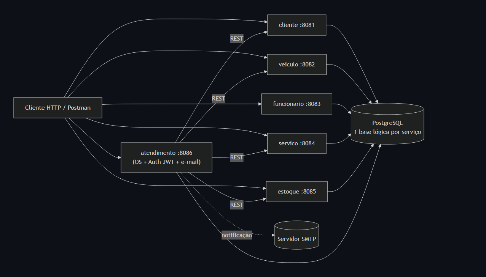
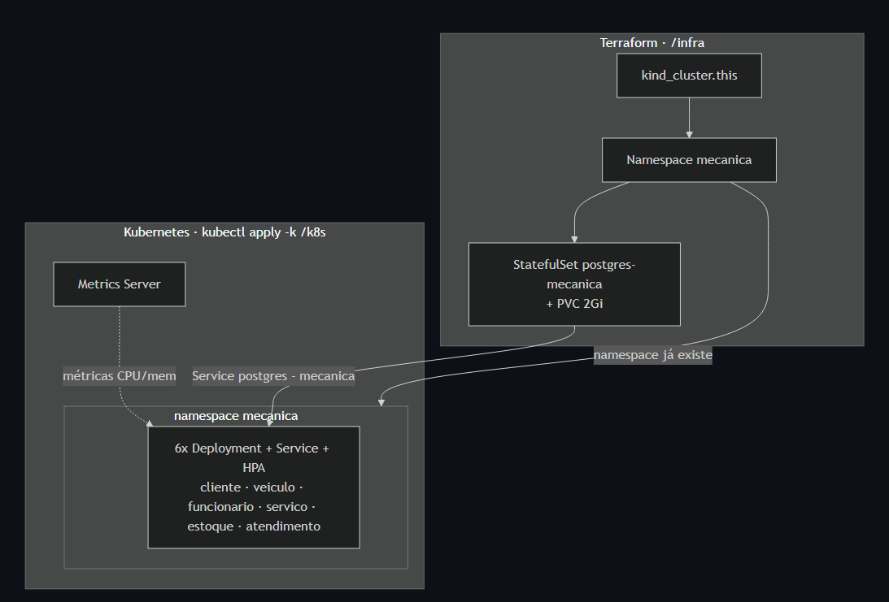
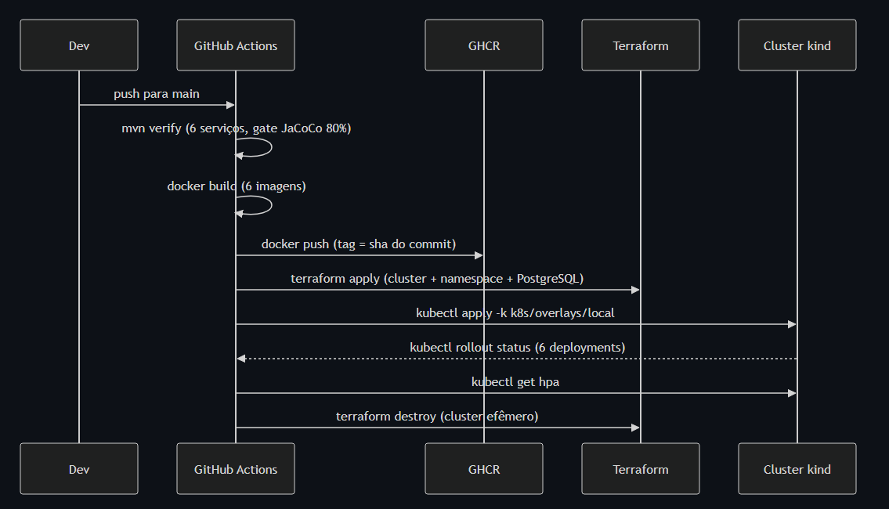
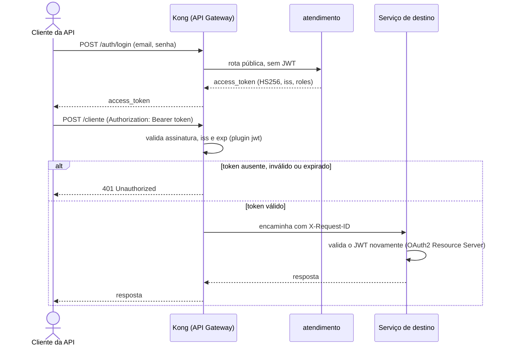
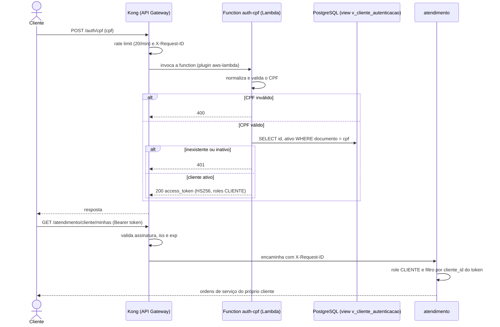
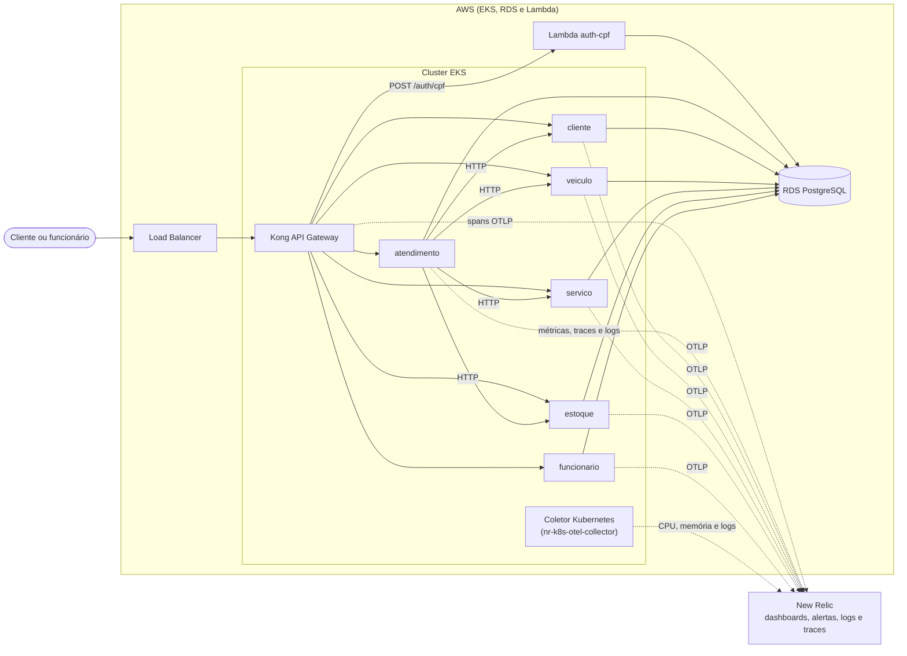

# Oficina Mecânica

Monorepo de microsserviços para gerenciamento de uma oficina mecânica. O sistema cobre cadastro de clientes, veículos,
serviços, estoque/insumos, abertura e acompanhamento de ordens de serviço, cálculo de orçamento, notificações,
autenticação JWT e controle de permissões por perfil.

O projeto está organizado como um monorepo Maven multi-módulo. No Kubernetes, a entrada única é o API Gateway
[Kong](#api-gateway-kong); no Docker Compose, cada serviço continua acessível pela sua própria porta.

## Objetivo

O objetivo do projeto é apoiar o fluxo principal de atendimento de uma oficina, desde a chegada do cliente até a entrega
do veículo, mantendo rastreabilidade da ordem de serviço e separando as responsabilidades entre atendente, mecânico,
administrador e cliente.

## Arquitetura

### Componentes da aplicação



No Kubernetes, o tráfego externo entra pelo API Gateway (Kong, ver [API Gateway](#api-gateway-kong)); no Docker
Compose, cada serviço é acessado diretamente pela sua porta. Apenas `atendimento` chama os demais serviços,
via HTTP (nunca via banco ou dependência Maven entre módulos).

### Infraestrutura provisionada



O Terraform provisiona **apenas** a infraestrutura de base (cluster + namespace + banco); os Deployments/Services/HPA da
aplicação são aplicados à parte via `kubectl apply -k` sobre `/k8s` — ver a seção
[Infraestrutura como Código (Terraform)](#infraestrutura-como-código-terraform) para a lista completa de recursos.

### Fluxo de deploy (CI/CD)



O cluster do CI é efêmero: criado e destruído a cada execução, prova real de que o provisionamento com Terraform e o
deploy com Kustomize funcionam de ponta a ponta a cada push.

Os guias de execução estão nas seções [Docker](#subindo-toda-a-aplicação-com-docker), [Kubernetes](#kubernetes),
[Terraform](#infraestrutura-como-código-terraform) e [CI/CD](#cicd).

## Microsserviços

| Serviço                | Porta | Banco (Docker)              | Responsabilidade                                              |
|------------------------|-------|-----------------------------|---------------------------------------------------------------|
| `services/cliente`     | 8081  | `postgres-cliente:5432`     | Cadastro de clientes                                          |
| `services/veiculo`     | 8082  | `postgres-veiculo:5433`     | Cadastro de veículos                                          |
| `services/funcionario` | 8083  | `postgres-funcionario:5434` | Cadastro de funcionários                                      |
| `services/servico`     | 8084  | `postgres-servico:5435`     | Cadastro de tipos de serviço                                  |
| `services/estoque`     | 8085  | `postgres-estoque:5436`     | Insumos e controle de estoque                                 |
| `services/atendimento` | 8086  | `postgres-atendimento:5437` | Ordens de serviço, autenticação JWT e notificações por e-mail |

Cada serviço em `services/<nome>` é um módulo Maven independente, com seu próprio `pom.xml`, `compose.yaml`, banco de
dados e ciclo de vida. Os serviços também podem ser acessados diretamente pela porta de cada um, mas a entrada recomendada é o API Gateway (Kong, `localhost:8080`).

O serviço `atendimento` concentra a autenticação de funcionários (`POST /auth/login`) e a autenticação de clientes é feita
por CPF em uma function serverless (`POST /auth/cpf`, ver [Autenticação por CPF](#autenticação-por-cpf-function-serverless)). O `atendimento` consome os demais serviços
(`cliente`, `veiculo`, `servico`, `estoque`) via HTTP (`RestClient`).

## Fluxo da Ordem de Serviço

Todos os endpoints abaixo são expostos pelo serviço `atendimento` (porta 8086).

1. O cliente solicita o atendimento para a atendente.
2. A atendente identifica ou cadastra o cliente (`services/cliente`, porta 8081) e o veículo (`services/veiculo`, porta
   8082).
3. A atendente inicia a ordem de serviço em `POST /atendimento/iniciar`.
4. A ordem nasce com status `RECEBIDA`.
5. O mecânico inicia o diagnóstico em `PATCH /atendimento/{id}/diagnostico/iniciar`.
6. O mecânico adiciona diagnóstico, serviços e insumos em `POST /atendimento/{id}/diagnostico`.
7. O sistema calcula o orçamento e altera a OS para `AGUARDANDO_APROVACAO`.
8. O cliente se autentica por CPF (`POST /auth/cpf`), acompanha as próprias OS por `GET /atendimento/cliente/minhas`,
   `GET /atendimento/{id}` e `GET /atendimento/{id}/status`, e registra a aprovação ou recusa do orçamento em
   `POST /atendimento/{id}/decisao-orcamento`. Com o token de cliente só é possível acessar OS do próprio cliente (as de
   outros respondem 404). A atendente também pode registrar a decisão em nome do cliente pelos endpoints internos abaixo.
9. Se aprovado (via `decisao-orcamento` ou `POST /atendimento/{id}/aprovar`, uso interno da atendente), o sistema baixa
   os insumos do estoque (`services/estoque`, porta 8085) e muda a OS para `EM_EXECUCAO`.
10. Se recusado (via `decisao-orcamento` ou `POST /atendimento/{id}/cancelar`, uso interno da atendente), o cancelamento
    é registrado.
11. O mecânico finaliza a execução em `POST /atendimento/{id}/finalizar`, e a OS passa para `FINALIZADA`.
12. A atendente entrega o veículo em `POST /atendimento/{id}/entregar`.

## Status da OS

- `RECEBIDA`: ordem criada e aguardando diagnóstico.
- `EM_DIAGNOSTICO`: veículo em avaliação técnica.
- `AGUARDANDO_APROVACAO`: orçamento calculado e aguardando retorno do cliente.
- `EM_EXECUCAO`: orçamento aprovado e serviço em andamento.
- `FINALIZADA`: serviço técnico concluído.
- `CANCELADA`: ordem cancelada após recusa do orçamento.
- `ENTREGUE`: veículo entregue ao cliente.

## Notificações

O serviço `atendimento` envia e-mails ao cliente durante o fluxo da OS e ao administrador quando falta estoque. Os
templates necessários estão na pasta `06 - Templates` da collection do Postman.

Para desabilitar os e-mails, use no `.env`:

```dotenv
NOTIFICACAO_EMAIL_REMETENTE=skip
NOTIFICACAO_EMAIL_ADMIN=skip
```

Para habilitar, configure o SMTP e substitua `skip` por endereços válidos:

```dotenv
MAIL_HOST=sandbox.smtp.mailtrap.io
MAIL_PORT=2525
MAIL_USERNAME=usuario-smtp
MAIL_PASSWORD=senha-smtp
MAIL_SMTP_AUTH=true
MAIL_SMTP_STARTTLS_ENABLE=true
NOTIFICACAO_EMAIL_REMETENTE=no-reply@oficina.com
NOTIFICACAO_EMAIL_ADMIN=estoque@oficina.com
```

Após alterar o `.env`, recrie o container:

```powershell
docker compose -f compose.app.yaml up -d --force-recreate atendimento
```

O e-mail do cliente é obtido automaticamente do cadastro. Falhas do SMTP são registradas nos logs e não interrompem a
operação principal.

## Perfis e Permissões

As APIs administrativas usam JWT emitido pelo serviço `atendimento`. O token carrega a role do funcionário autenticado.

- `ADMIN`: acesso total ao sistema, incluindo funcionários, templates, relatórios e operações administrativas.
- `ATENDENTE`: opera clientes, veículos, estoque, abertura de atendimento, aprovação de orçamento, cancelamento e
  entrega da OS.
- `MECANICO`: opera serviços, estoque, diagnóstico, inclusão de serviços/insumos na OS e finalização técnica.
- `CLIENTE`: autentica por CPF (`POST /auth/cpf`) e acessa apenas as próprias ordens de serviço: `GET /atendimento/cliente/minhas`,
  `GET /atendimento/{id}`, `GET /atendimento/{id}/status` e `POST /atendimento/{id}/decisao-orcamento`.

Endpoints públicos:

- `POST /auth/login` (`services/atendimento`, porta 8086)
- `POST /auth/cpf` (function de autenticação por CPF; só existe atrás do API Gateway)
- Todos os endpoints `GET` dos demais serviços (`cliente`, `veiculo`, `funcionario`, `servico`, `estoque`)
- `/actuator/health/**` de cada serviço
- `/swagger-ui/**` e `/v3/api-docs/**` de cada serviço

## Requisitos

Para rodar com Docker:

- Docker e Docker Compose
- Git

Não é necessário instalar Java localmente para subir os bancos de dados via Docker.

Para rodar os serviços fora do Docker:

- Java 21
- Git

O projeto possui Maven Wrapper, então não é necessário instalar Maven localmente.

## Estrutura do Monorepo

```text
mecanica/
├── .github/workflows/           # Pipelines de CI/CD
├── docker/                      # Inicialização do PostgreSQL local
├── functions/auth-cpf/          # Function serverless de autenticação por CPF (código, Dockerfile, Terraform, CI/CD)
├── infra/                       # Cluster kind e PostgreSQL locais (Terraform); infra/aws: VPC + EKS na AWS
├── infra-db/                    # RDS PostgreSQL na AWS (Terraform)
├── k8s/                         # Manifestos Kubernetes e overlays Kustomize
├── scripts/                     # Smoke test e automação do AWS Academy (bootstrap, secrets, destroy)
├── postman/                     # Collections por microsserviço e collection completa
├── pom.xml                      # Root POM (packaging pom), dependencyManagement e plugins
└── services/                    # Módulos dos microsserviços (Maven multi-módulo)
    ├── pom.xml                  # POM agregador dos módulos de serviço
    ├── cliente/                 # Microsserviço de Clientes (porta 8081)
    ├── veiculo/                 # Microsserviço de Veículos (porta 8082)
    ├── funcionario/             # Microsserviço de Funcionários (porta 8083)
    ├── servico/                 # Microsserviço de Serviços (porta 8084)
    ├── estoque/                 # Microsserviço de Estoque/Insumos (porta 8085)
    └── atendimento/             # Microsserviço de Ordens de Serviço + Auth/JWT embutido (porta 8086)
```

Cada `services/<nome>` possui, no mínimo:

```text
services/<nome>/
├── pom.xml               # Dependências, testes, JaCoCo do serviço
├── compose.yaml          # PostgreSQL exclusivo do serviço
└── src/
    ├── main/java/...     # controller, service, repository, domain, dto, exception, config, infra
    └── test/java/...     # testes unitários e de integração
```

## Executando um Microsserviço isoladamente

O arquivo `compose.app.yaml` executa a aplicação completa. Para desenvolver ou testar apenas um microsserviço, cada
serviço também possui seu próprio `compose.yaml`, responsável pelo PostgreSQL correspondente.

Para subir o banco de dados de um serviço (exemplo com `cliente`):

```bash
docker compose -f services/cliente/compose.yaml up -d
```

Repita o comando trocando `cliente` pelo nome do serviço desejado (`veiculo`, `funcionario`, `servico`, `estoque`,
`atendimento`).

Em seguida, execute a aplicação do serviço (Linux/macOS):

```bash
./mvnw -pl services/cliente spring-boot:run
```

No Windows:

```powershell
.\mvnw.cmd -pl services/cliente spring-boot:run
```

Ao executar um serviço diretamente pela IDE ou Maven, os valores locais padrão continuam disponíveis. O Compose completo
exige `MECANICA_POSTGRES_USER`, `MECANICA_POSTGRES_PASSWORD` e `MECANICA_JWT_SECRET` no `.env` para não manter
credenciais fixas no YAML. O prefixo evita colisões com outras stacks do monorepo.

## Subindo toda a aplicação com Docker

Na primeira execução, crie o `.env` local a partir do exemplo:

```powershell
Copy-Item .env.example .env
```

Revise pelo menos `MECANICA_POSTGRES_USER`, `MECANICA_POSTGRES_PASSWORD`, `MECANICA_JWT_SECRET`, `MECANICA_ADMIN_EMAIL`
e `MECANICA_ADMIN_PASSWORD`. Os valores do exemplo são exclusivos para desenvolvimento local.

Para construir e iniciar os seis microsserviços e o PostgreSQL de uma vez:

```powershell
docker compose -f compose.app.yaml up -d --build
```

O PostgreSQL desse compose cria um banco independente para cada microsserviço. As APIs ficam disponíveis nas portas
`8081` a `8086` e também pelo API Gateway (Kong) em `http://localhost:8080` (ver [API Gateway](#api-gateway-kong)). O
Kong usa a mesma configuração do Kubernetes (`k8s/addons/kong/base/kong.yml.tpl`).

Cada imagem compila somente o microsserviço indicado no argumento `SERVICE`. Os containers são considerados saudáveis
quando `GET /actuator/health/readiness` responde com sucesso.

Para acompanhar o estado dos containers:

```powershell
docker compose -f compose.app.yaml ps
```

Para encerrar a aplicação sem apagar os bancos:

```powershell
docker compose -f compose.app.yaml down
```

## Infraestrutura como Código (Terraform)

O módulo [`infra/`](infra/) provisiona a infraestrutura local exigida pela Fase 2. Os manifests da aplicação continuam
sob responsabilidade do Kustomize em `k8s/`.

| Arquivo              | Recurso criado                                                           |
|----------------------|--------------------------------------------------------------------------|
| `infra/cluster.tf`   | Cluster Kubernetes local com kind                                        |
| `infra/namespace.tf` | Namespace `mecanica`                                                     |
| `infra/database.tf`  | Secret e ConfigMap do PostgreSQL, StatefulSet com PVC de 2 Gi e Services |

Pré-requisitos: Docker em execução, Terraform 1.9 ou superior e `kubectl`. Para criar o cluster, namespace, PostgreSQL e
os seis bancos lógicos:

```powershell
Set-Location infra
terraform init
terraform apply
Set-Location ..
```

O kind registra o contexto `kind-mecanica` no kubeconfig. Se necessário, exporte-o novamente:

```powershell
kind export kubeconfig --name mecanica
```

O PostgreSQL usa `var.postgres_username` e `var.postgres_password`. Esses valores devem coincidir com
`DATABASE_USERNAME` e `DATABASE_PASSWORD` de `k8s/overlays/local/secrets/shared.env`. Os valores dos arquivos
`.env.example` já são compatíveis com os defaults locais do Terraform.

Para destruir todo o ambiente local de forma consistente, incluindo cluster e banco:

```powershell
Set-Location infra
terraform destroy
Set-Location ..
```

Não remova o namespace `mecanica` manualmente enquanto ele estiver no estado do Terraform, pois isso também apaga o
PostgreSQL e deixa o estado dessincronizado.

## Kubernetes

Os manifestos usam Kustomize e estão organizados assim:

```text
k8s/
├── base/                         # 6 Deployments, Services, ConfigMaps e HPAs
├── overlays/
│   ├── local/                    # Secrets e imagens locais
│   ├── homologacao/              # EKS: imagens, RDS e Kong com LoadBalancer
│   └── production/               # EKS: idem, com mais réplicas mínimas
└── addons/                       # kong (local e aws), auth-cpf, rds, metrics-server
```

Configuração principal:

- Services `ClusterIP` nas portas 8081 a 8086;
- init containers aguardando o PostgreSQL;
- probes de startup, liveness e readiness via Spring Boot Actuator;
- shutdown gracioso de 30 segundos no Spring e 45 segundos no Pod;
- HPA `autoscaling/v2`, com CPU em 70%, memória em 75% e máximo de 5 réplicas;
- mínimo de 1 réplica local e 2 em produção;
- Metrics Server v0.9.0.

| Serviços                                         | Requests         | Limits           |
|--------------------------------------------------|------------------|------------------|
| cliente, veiculo, funcionario, servico e estoque | 100m CPU / 384Mi | 500m CPU / 512Mi |
| atendimento                                      | 200m CPU / 512Mi | 750m CPU / 768Mi |

### Ambiente local

Depois do `terraform apply`, construa as imagens e carregue-as no cluster kind:

```powershell
docker compose -f compose.app.yaml build
kind load docker-image mecanica/cliente:local mecanica/veiculo:local mecanica/funcionario:local mecanica/servico:local mecanica/estoque:local mecanica/atendimento:local mecanica/auth-cpf:local --name mecanica
```

Se mudar `auth-cpf-view.sql` e reaplicar o overlay, apague antes o Job `auth-cpf-db-init` (`kubectl delete job auth-cpf-db-init -n mecanica`): o template de um Job é imutável.

Crie os arquivos locais de Secrets, ignorados pelo Git:

```powershell
Copy-Item k8s/overlays/local/secrets/shared.env.example k8s/overlays/local/secrets/shared.env
Copy-Item k8s/overlays/local/secrets/atendimento.env.example k8s/overlays/local/secrets/atendimento.env
Copy-Item k8s/overlays/local/secrets/external-services.env.example k8s/overlays/local/secrets/external-services.env
Copy-Item k8s/overlays/local/secrets/auth-cpf.env.example k8s/overlays/local/secrets/auth-cpf.env
```

Instale o Metrics Server e aplique a aplicação:

```powershell
kubectl apply -k k8s/addons/metrics-server/overlays/local
kubectl apply -k k8s/overlays/local
kubectl wait --for=condition=available deployment --all -n mecanica --timeout=300s
```

O overlay local habilita `--kubelet-insecure-tls` apenas para o Metrics Server do kind. Essa opção não é aplicada em
produção.

Confira os recursos e as métricas:

```powershell
kubectl get pods,services,hpa -n mecanica
kubectl top pods -n mecanica
```

O acesso externo é feito pelo API Gateway (próxima seção). Para acessar um serviço diretamente, use port-forward.
Exemplo:

```powershell
kubectl port-forward service/atendimento 8086:8086 -n mecanica
```

Se o Compose estiver usando as portas 8081 a 8086, encerre-o antes do port-forward. Para a collection completa,
encaminhe também os Services das portas 8081 a 8085.

### API Gateway (Kong)

O Kong roda em modo DB-less (configuração declarativa em `k8s/addons/kong/base/kong.yml.tpl`) e é a entrada única do
cluster. No ambiente local ele já é aplicado junto com a aplicação (`kubectl apply -k k8s/overlays/local`), porque
precisa do Secret `mecanica-shared-secrets` com o nome gerado pelo Kustomize:

```powershell
kubectl rollout status deployment/kong -n mecanica
```

No kind, o gateway fica em `http://localhost:8080` (NodePort 30080, variável Terraform `gateway_host_port`). Em
produção o Service é `LoadBalancer`. Rotas:

| Prefixo | Serviço | Acesso |
|---|---|---|
| `/cliente`, `/veiculos`, `/funcionarios`, `/servicos`, `/estoque` | respectivos serviços | `GET` público; demais métodos exigem JWT |
| `/auth/login` | atendimento | público |
| `POST /auth/cpf` | function `auth-cpf` (Lambda) | público, com rate limit de 20 req/min por IP |
| `GET /cliente/documento` | cliente | exige JWT (retorna dados pessoais) |
| `/atendimento/*` e `/templates` | atendimento | exigem JWT (de funcionário ou de cliente, conforme a role do endpoint) |

O Kong valida a assinatura (HS256), o `iss` e o `exp` dos tokens emitidos por `POST /auth/login` (funcionários) e por
`POST /auth/cpf` (clientes), e os serviços continuam
validando o token. Também adiciona o cabeçalho `X-Request-ID` (correlação), CORS e rate limiting (600 req/min por IP).
Exemplo:

```powershell
curl -X POST http://localhost:8080/auth/login -H "Content-Type: application/json" -d '{"email":"admin@mecanica.com","senha":"admin123"}'
```

Fluxo de autenticação e de uma chamada protegida:



Em produção, o overlay ajusta `CORS_ORIGIN` para o domínio real e `KONG_REAL_IP_HEADER`/`KONG_TRUSTED_IPS` para que o
rate limiting identifique o IP do cliente atrás do LoadBalancer (ajuste `KONG_TRUSTED_IPS` ao CIDR do balanceador). As
imagens `kong` e `busybox` são fixadas por digest.

### Autenticação por CPF (function serverless)

`POST /auth/cpf` com `{"cpf": "529.982.247-25"}` é atendido pela function `functions/auth-cpf` (Node.js 22/TypeScript),
empacotada como imagem de AWS Lambda. O Kong invoca a function com o plugin `aws-lambda`: na AWS é a Lambda real
(`functions/auth-cpf/infra`); no Compose e no kind é a mesma imagem com o Runtime Interface Emulator.

A function valida o CPF (dígitos verificadores), consulta o cliente na view `v_cliente_autenticacao` do banco do `cliente`
com um usuário PostgreSQL somente leitura (`auth_cpf_ro`) e devolve um JWT HS256 (`iss`, `sub`, `cliente_id`,
`roles: ["CLIENTE"]`, validade de 1 hora) aceito pelo Kong e pelos serviços. CPF inválido responde 400; CPF inexistente ou
cliente inativo respondem 401 com a mesma mensagem (evita enumeração de CPFs). Os logs são JSON e carregam o
`X-Request-ID` do Kong como `correlation_id`.

```powershell
curl -X POST http://localhost:8080/auth/cpf -H "Content-Type: application/json" -d '{"cpf":"529.982.247-25"}'
curl http://localhost:8080/atendimento/cliente/minhas -H "Authorization: Bearer <access_token>"
```



### Secrets

| Secret                      | Chaves esperadas                                                  |
|-----------------------------|-------------------------------------------------------------------|
| `mecanica-shared-secrets`   | `DATABASE_USERNAME`, `DATABASE_PASSWORD`, `JWT_SECRET`            |
| `atendimento-secrets`       | `ADMIN_EMAIL`, `ADMIN_PASSWORD`, `MAIL_USERNAME`, `MAIL_PASSWORD` |
| `external-services-secrets` | `EXTERNAL_SERVICE_TOKEN`, reservado para integrações futuras      |
| `auth-cpf-secrets`          | `AUTH_CPF_DB_PASSWORD`, senha do usuário somente leitura da function de CPF (só no overlay local) |
| `newrelic-secrets`          | `NEW_RELIC_LICENSE_KEY` (opcional; sem ela a exportação de telemetria fica desligada), ver [Observabilidade](#observabilidade) |

O `JWT_SECRET` deve ser igual nos seis serviços e ter ao menos 32 bytes. Kubernetes Secrets em Base64 não são
criptografia; em produção, use um gerenciador de segredos ou External Secrets e nunca versione valores reais.

Trocar `DATABASE_PASSWORD` no Secret não altera a senha de um PostgreSQL já inicializado. Da mesma forma,
`ADMIN_PASSWORD` é usado somente ao criar o administrador inicial; rotações precisam ser coordenadas no banco.

### Produção e homologação na AWS

Veja o passo a passo completo em [Deploy na AWS (AWS Academy)](#deploy-na-aws-aws-academy). Os overlays
`k8s/overlays/homologacao` e `k8s/overlays/production` apontam o Service `postgres-mecanica` (`ExternalName`) para o RDS,
sobem o Kong como `LoadBalancer` (que invoca a Lambda com as credenciais da `LabRole` dos nós) e executam dois Jobs: um cria
os seis bancos lógicos no RDS e o outro aplica a view `v_cliente_autenticacao`. Os Secrets são criados pelo pipeline a
partir dos secrets do GitHub; nenhum valor sensível é versionado.

### Validação

Sem acessar um cluster, valide a renderização:

```powershell
kubectl kustomize k8s/base
kubectl kustomize k8s/overlays/local
kubectl kustomize k8s/overlays/production
kubectl kustomize k8s/overlays/homologacao
kubectl kustomize k8s/addons/metrics-server/overlays/local
kubectl kustomize k8s/addons/metrics-server/overlays/production
```

Com o cluster ativo, valide os recursos contra a API antes de aplicar:

```powershell
kubectl apply --dry-run=server -k k8s/overlays/local
```

Limitações conhecidas antes de produção real:

- `ddl-auto: update` ainda altera o schema na inicialização e deve ser substituído por migrações versionadas;
- a criação do administrador precisa ser atômica quando houver múltiplas réplicas;
- o HPA de memória de aplicações JVM deve ser calibrado com métricas reais;
- o script SQL local só executa quando o PVC do PostgreSQL está vazio.

## Deploy na AWS (AWS Academy)

Dois ambientes completos (`homologacao` e `producao`), cada um com VPC, EKS, RDS PostgreSQL, Lambda `auth-cpf` e Kong
como `LoadBalancer`. Ambos usam a `LabRole` existente do Learner Lab, porque o lab não permite criar usuários, roles ou
provedores OIDC.

```text
GitHub Actions ─► infra/aws (VPC+EKS) ─► infra-db (RDS) ─► functions/auth-cpf (ECR+Lambda) ─► kubectl apply -k
Cliente ─► LoadBalancer ─► Kong ─► serviços (EKS) ─► RDS        Kong ─► Lambda auth-cpf ─► RDS (view somente leitura)
```

| Terraform | State (S3) | Conteúdo |
|---|---|---|
| `infra/aws` | `infra-k8s/<ambiente>.tfstate` | VPC, subnets, NAT, EKS e grupo de nós (homologação: 2 `t3.medium`; produção: 2 a 4 `t3.large`) |
| `infra-db` | `infra-db/<ambiente>.tfstate` | RDS PostgreSQL 16 privado, acessível só pelos nós |
| `functions/auth-cpf/infra` | `auth-cpf/<ambiente>.tfstate` | ECR, Lambda em subnets privadas, Secrets Manager |

### Passo a passo

1. **Iniciar o lab** e copiar as credenciais (`AWS Details`) para `~/.aws/credentials` (perfil `default` com
   `aws_session_token`). Elas expiram em cerca de 4 horas.
2. **Bucket do state e verificação da `LabRole`** (uma vez): `scripts/aws-lab-bootstrap.sh`.
3. **Configurar o GitHub** (uma vez por ambiente): `gh auth login` e, na raiz do repositório,
   `scripts/aws-lab-secrets.sh homologacao` e `scripts/aws-lab-secrets.sh producao`. O script cria o Environment, a variável
   `TF_STATE_BUCKET` e os secrets (`AWS_*`, `JWT_SECRET`, `DATABASE_PASSWORD`, `AUTH_CPF_DB_PASSWORD`, `ADMIN_PASSWORD`) e imprime
   a senha do administrador. Para a [observabilidade](#observabilidade), defina antes `NEW_RELIC_LICENSE_KEY`, `NEW_RELIC_API_KEY`,
   `NEW_RELIC_ACCOUNT_ID` e `ALERT_EMAIL` no terminal (opcionais). No GitHub, ative aprovação manual no Environment `producao`, proteja a `main` e torne públicos os
   pacotes do GHCR.
4. **Implantar**: faça push na branch `homologacao` (ou `main`) ou execute o workflow *Deploy AWS*. Leva cerca de 25 minutos
   (EKS e RDS). O último passo imprime o endereço do Kong (`http://<hostname-do-load-balancer>`).
5. **Validar**: `scripts/smoke-test.sh http://<hostname> admin@mecanica.com <senha>` e a collection Postman com o
   `gatewayUrl` apontando para o hostname.
6. **A cada nova sessão do lab**: credenciais novas em `~/.aws/credentials` e
   `RENOVAR_APENAS_CREDENCIAIS=1 scripts/aws-lab-secrets.sh <ambiente>`.
7. **Destruir ao terminar**: `scripts/aws-lab-down.sh <ambiente>` (remove o namespace, o balanceador, a Lambda, o RDS e o EKS).
   Para remover também os dashboards e alertas do New Relic, exporte `NEW_RELIC_API_KEY` e `NEW_RELIC_ACCOUNT_ID` antes de rodar;
   sem elas essa etapa é ignorada.
   Duas stacks custam cerca de US$ 0,75 por hora; não deixe ligadas fora das sessões.

Execução manual (sem o pipeline): `terraform init -backend-config="bucket=<bucket>" -backend-config="key=infra-k8s/<ambiente>.tfstate"
-backend-config="region=us-east-1" -backend-config="use_lockfile=true"` seguido de `terraform apply -var-file=envs/<ambiente>.tfvars` em
`infra/aws`, `infra-db` e `functions/auth-cpf/infra` (nessa ordem), e `kubectl apply -k k8s/overlays/<production|homologacao>`.

## CI/CD

O GitHub Actions automatiza a validação e a implantação:

- [Pull Request Validation](.github/workflows/maven.yml) executa build, testes e verificação de cobertura dos seis
  microsserviços e testes da function `auth-cpf` em pull requests para `main`;
- [Deploy AWS](.github/workflows/deploy-aws.yml) é acionado em pushes para `homologacao` (ambiente de homologação) e
  `main` (produção, com aprovação do Environment do GitHub): testa e publica as imagens, aplica o Terraform da rede/EKS e
  do RDS, publica a Lambda, instala o coletor de Kubernetes do New Relic, aplica os manifestos no EKS, executa o smoke test
  pelo `LoadBalancer` do Kong e cria os dashboards e alertas (`observability/`);
- [Continuous Deployment](.github/workflows/cd.yml) é acionado manualmente, executa novamente
  os testes, publica as seis imagens dos serviços e a da function `auth-cpf` no GHCR, provisiona um cluster kind efêmero e o PostgreSQL com Terraform, aplica os
  manifestos Kubernetes, valida o rollout e executa smoke tests do gateway e da autenticação por CPF.

As imagens publicadas no GHCR devem estar com visibilidade pública. Assim, o cluster e quem estiver avaliando o
projeto podem baixá-las sem configurar `GHCR_TOKEN` ou uma credencial de pull. O `GITHUB_TOKEN` automático continua
sendo usado somente pelo workflow para publicar as imagens.

## Observabilidade

A observabilidade usa o **New Relic** (plano gratuito) com **OpenTelemetry nativo do Spring Boot 4** (Micrometer + OTLP),
sem java agent. Métricas, traces e logs saem dos seis serviços e do Kong; o coletor de Kubernetes envia CPU, memória e
logs dos contêineres. Os dashboards e alertas são criados por Terraform em [`observability/`](observability).



### O que é monitorado

| Requisito | Como é atendido | Onde ver |
|---|---|---|
| Latência das APIs | `http.server.requests` (histograma por serviço, rota e status) | Dashboard, página **APIs** |
| CPU e memória do Kubernetes | Coletor `nr-k8s-otel-collector` (Helm), por pod e por nó | Dashboard, página **Kubernetes** |
| Healthchecks e uptime | Probes do Actuator, `process.uptime` e alerta de perda de sinal | Página **Saúde e uptime** |
| Alertas de falha no processamento de OS | 5xx no `atendimento`, falha de integração e falha de e-mail | Política de alertas |
| Logs JSON com correlação | `request_id` e `trace.id` em todos os logs | Página **Logs** |
| Volume diário de OS | `os.criadas` | Página **Negócio** |
| Tempo médio por status | `os.status.duracao{status}` (diagnóstico, execução, finalização e demais) | Página **Negócio** |
| Erros e falhas nas integrações | `http.client.requests` do `atendimento` para os outros serviços | Página **Negócio** |

### Logs estruturados e correlação

Todos os serviços escrevem logs em JSON no stdout (`logging.structured.format.console`). Cada requisição gera uma linha:

```json
{"@timestamp":"2026-10-17T03:06:38.223Z","message":"Requisição concluída","level":"INFO","trace.id":"00749b4be4e7df894e26ecdc2c327311","span.id":"08db29214df093ca","request_id":"5258dadb-df07-450a-91db-45e373725ceb","metodo":"POST","rota":"/atendimento/iniciar","status":200,"duracao_ms":33,"service.name":"atendimento-service","deployment.environment":"compose"}
```

- O Kong gera o `X-Request-ID`; o `RequestIdFilter` de cada serviço o coloca no MDC (`request_id`) e o devolve no response.
  O `atendimento` repassa o mesmo cabeçalho nas chamadas a `cliente`, `veiculo`, `servico` e `estoque`.
- O `trace.id` e o `span.id` vêm do Micrometer Tracing e acompanham o cabeçalho W3C `traceparent`, também propagado nas
  chamadas entre serviços e emitido pelo Kong.
- O log de acesso do Kong também é JSON e traz o mesmo `request_id`; a Lambda `auth-cpf` registra `correlation_id` com o mesmo valor.
- Os probes do Actuator (`/actuator/**`) não geram logs, métricas nem spans.

Para seguir uma requisição: pegue o `request_id` no log do Kong (ou no header `X-Request-ID` da resposta) e busque por ele
nos logs dos serviços, ou abra o trace pelo `trace.id`.

### Métricas de negócio

| Métrica | Tipo | Descrição |
|---|---|---|
| `os.criadas` | contador | Ordens de serviço abertas (volume diário) |
| `os.status.duracao{status}` | timer (ms) | Tempo que a OS ficou em cada status antes de mudar |
| `os.transicoes{de,para}` | contador | Transições de status |
| `notificacao.falhas` | contador | Falhas no envio de e-mail |

Além delas, os serviços exportam as métricas padrão do Micrometer (`http.server.requests`, `http.client.requests`,
JVM, Hikari e `process.uptime`). O `atendimento` usa o `RestClient.Builder` do Spring Boot, com timeouts de conexão (2 s) e
leitura (10 s), o que gera `http.client.requests` por serviço de destino (`client.name`).

### Traces

Um trace completo atravessa o gateway e os serviços (Kong, `atendimento`, `cliente` e `veiculo` na abertura de uma OS),
com a amostragem de 100%. No New Relic, abra **APM e serviços** (ou *Distributed tracing*) e filtre por
`deployment.environment`.

### Alertas

| Condição | Dispara quando |
|---|---|
| Falha no processamento de ordens de serviço | O `atendimento` responde 5xx (5 min) |
| Falha na integração entre serviços | `http.client.requests` com 5xx ou sem resposta |
| Falha no envio de notificações por e-mail | `notificacao.falhas` > 0 |
| Latência p95 das APIs | p95 acima de 1500 ms por 5 min |
| Serviço sem enviar dados (uptime) | Um serviço deixa de reportar métricas por 5 min |
| Pod reprovado no healthcheck | Pod não pronto (readiness) por 5 min |
| Memória dos contêineres | Mais de 90% do limite por 5 min |

Os alertas chegam por e-mail (`ALERT_EMAIL`).

### Como ativar

A exportação vem **desligada** (`OBSERVABILITY_EXPORT_ENABLED=false`): sem conta, tudo roda normalmente e os logs JSON e o
`trace.id` continuam no stdout. Para ligar, crie uma conta gratuita do New Relic e use a *License Key* (tipo *Ingest*).

- **Docker Compose:** no `.env`, defina `OBSERVABILITY_EXPORT_ENABLED=true` e `NEW_RELIC_LICENSE_KEY=<chave>`
  (contas da região EU: `OTLP_ENDPOINT=https://otlp.eu01.nr-data.net`), depois `docker compose -f compose.app.yaml up -d`.
- **AWS (pipeline):** exporte `NEW_RELIC_LICENSE_KEY`, `NEW_RELIC_API_KEY` (*User API key*), `NEW_RELIC_ACCOUNT_ID` e
  `ALERT_EMAIL` e rode `scripts/aws-lab-secrets.sh <ambiente>`. O workflow *Deploy AWS* cria o Secret `newrelic-secrets`,
  instala o coletor (`k8s/addons/newrelic/values.yaml`) e aplica o Terraform de `observability/`. Os overlays de
  homologação e produção já habilitam a exportação.
- **Terraform manual:** em `observability/`, `export NEW_RELIC_API_KEY=... NEW_RELIC_ACCOUNT_ID=...` e
  `terraform init -backend-config="bucket=<bucket>" -backend-config="key=observability/<ambiente>.tfstate" -backend-config="region=us-east-1" -backend-config="use_lockfile=true"`,
  seguido de `terraform apply -var-file=envs/<ambiente>.tfvars -var="alert_email=<e-mail>"`.

O `scripts/aws-lab-down.sh` destrói primeiro os dashboards e alertas do ambiente (se `NEW_RELIC_API_KEY` e `NEW_RELIC_ACCOUNT_ID`
estiverem exportados), para que a derrubada do cluster não dispare alertas de perda de sinal.

Na nuvem (homologação e produção) a exportação já vem ligada nos overlays, então a `NEW_RELIC_LICENSE_KEY` passa a ser
obrigatória: sem ela os serviços e o Kong tentam enviar dados sem autenticação e recebem erro do New Relic a cada minuto, o que
só polui os logs. Para desligar, defina `OBSERVABILITY_EXPORT_ENABLED: "false"` nos `patches/common-config.yaml` dos overlays.

### Demonstração

`scripts/gerar-trafego.sh <url-do-gateway> <email-admin> <senha-admin> [quantidade] [pausa]` percorre o ciclo completo da OS
(abertura, diagnóstico, aprovação, execução, finalização e entrega), cancela uma a cada quatro e provoca um erro de estoque
insuficiente e uma consulta a OS inexistente. Use-o para popular os dashboards antes de gravar a demonstração.

## Configuração do Serviço `atendimento`

O serviço `atendimento` concentra autenticação JWT, notificações por e-mail e integrações HTTP com os demais serviços.
As variáveis usadas pelo Compose ficam no `.env`; consulte `.env.example` para os valores locais:

- `SPRING_DATASOURCE_URL`, `SPRING_DATASOURCE_USERNAME`, `SPRING_DATASOURCE_PASSWORD`: banco `mecanica_atendimento`.
- `MECANICA_JWT_SECRET` (mínimo 32 caracteres), `MECANICA_JWT_EXPIRATION_SECONDS`, `MECANICA_JWT_ISSUER`:
  emissão/validação do token JWT no Compose.
- `MECANICA_ADMIN_EMAIL`, `MECANICA_ADMIN_PASSWORD`, `MECANICA_ADMIN_NOME`: admin criado automaticamente na
  inicialização do serviço pelo Compose.
- `MAIL_HOST`, `MAIL_PORT`, `MAIL_USERNAME`, `MAIL_PASSWORD`: envio de e-mail.
- `NOTIFICACAO_EMAIL_ADMIN`, `NOTIFICACAO_EMAIL_REMETENTE`: notificações administrativas (`skip` por padrão).
- `CLIENTE_SERVICE_URL`, `VEICULO_SERVICE_URL`, `SERVICO_SERVICE_URL`, `ESTOQUE_SERVICE_URL`: URLs base dos demais
  serviços (por padrão, `http://localhost:<porta>` de cada um).

## Admin Padrão

Ao iniciar, o serviço `atendimento` cria automaticamente um funcionário administrador caso ele ainda não exista.

Credenciais padrão:

```text
email: admin@mecanica.com
senha: admin123
```

Esses valores podem ser alterados por variáveis de ambiente:

```env
ADMIN_EMAIL=admin@mecanica.com
ADMIN_PASSWORD=admin123
ADMIN_NOME=Administrador Padrão
```

## Login JWT

Faça login em:

```http
POST http://localhost:8086/auth/login
```

Body:

```json
{
  "email": "admin@mecanica.com",
  "senha": "admin123"
}
```

A resposta retorna um token JWT. Use esse token como Bearer Token nos endpoints administrativos:

```http
Authorization: Bearer <token>
```

## Postman

A [collection completa do Postman](postman/mecanica-completa.postman_collection.json) cobre todos os endpoints dos seis
microsserviços e já contém as URLs locais, autenticação Bearer e scripts para salvar o token e os IDs criados. As
collections separadas por microsserviço também permanecem em `postman/`.

Para usar:

1. Baixe e importe a [collection completa](postman/mecanica-completa.postman_collection.json) ou a collection do serviço
   desejado.
2. Suba o banco do serviço (`docker compose -f services/<nome>/compose.yaml up -d`) e inicie a aplicação
   (`./mvnw -pl services/<nome> spring-boot:run`).
3. Na collection unificada, execute primeiro `00 - Autenticação > Login e salvar token` (porta 8086).
4. Para chamar pelo API Gateway, importe também um environment de `postman/environments/` e selecione-o:
   - [`gateway.postman_environment.json`](postman/environments/gateway.postman_environment.json): todas as
     chamadas passam pelo Kong em `http://localhost:8080` (Compose ou kind);
   - [`direto.postman_environment.json`](postman/environments/direto.postman_environment.json): portas `8081` a
     `8086` dos serviços, igual ao comportamento padrão da collection.

O script do request de login salva o token JWT automaticamente na variável `accessToken`. Os cadastros também atualizam
automaticamente `clienteId`, `veiculoId`, `funcionarioId`, `servicoId` e `insumoId` para uso nas requisições seguintes.

## Testes

Para rodar os testes de um serviço isoladamente (Linux/macOS):

```bash
./mvnw -pl services/cliente -am verify
```

No Windows:

```powershell
.\mvnw.cmd -pl services/cliente -am verify
```

Para rodar os testes de todos os serviços de uma vez:

```bash
./mvnw -pl services/cliente,services/veiculo,services/funcionario,services/servico,services/estoque,services/atendimento -am verify
```

Os testes usam profile de teste com H2 em memória, então não dependem do PostgreSQL local. A cobertura mínima
obrigatória é de 80% de linhas e branches por serviço, validada via JaCoCo (`jacoco-check`).

Para gerar relatório de cobertura JaCoCo de um serviço:

```bash
./mvnw -pl services/cliente test jacoco:report
```

O relatório fica em:

```text
services/cliente/target/site/jacoco/index.html
```

## Parar e Limpar Docker

Parar toda a aplicação sem apagar o banco:

```powershell
docker compose -f compose.app.yaml down
```

Limpar completamente a aplicação, incluindo o volume do PostgreSQL e as imagens locais:

```powershell
docker compose -f compose.app.yaml down -v --rmi local --remove-orphans
```

O segundo comando apaga definitivamente os dados locais dos seis bancos. Na próxima subida,
`docker/postgres/init-databases.sql` será executado novamente.

Parar o banco de um serviço:

```bash
docker compose -f services/cliente/compose.yaml down
```

Use comandos com `-v` apenas quando quiser descartar os dados persistidos localmente.

## Problemas Comuns

Se um serviço com autenticação (`atendimento`) falhar por causa do JWT:

- confira se `JWT_SECRET` está definido no ambiente onde o serviço roda;
- confira se a secret tem pelo menos 32 caracteres.

Se a porta estiver ocupada:

- `cliente` usa `8081`, `veiculo` usa `8082`, `funcionario` usa `8083`, `servico` usa `8084`, `estoque` usa `8085`,
  `atendimento` usa `8086`;
- os bancos PostgreSQL de cada serviço usam `5432` (`cliente`), `5433` (`veiculo`), `5434` (`funcionario`), `5435`
  (`servico`), `5436` (`estoque`) e `5437` (`atendimento`);
- pare outros serviços nessas portas ou ajuste o `compose.yaml`/variáveis de ambiente do serviço correspondente.

Se o login falhar após limpar volumes:

- aguarde o serviço `atendimento` terminar de subir;
- confira nos logs se o admin padrão foi criado;
- use as credenciais padrão ou as variáveis `ADMIN_EMAIL` e `ADMIN_PASSWORD` configuradas.
