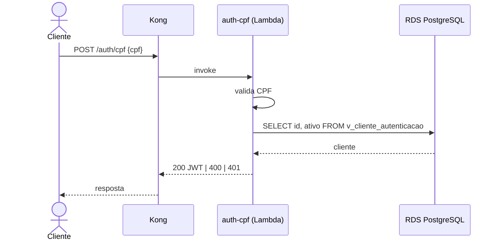

# auth-cpf

Function serverless de autenticação por CPF da Oficina Mecânica. Valida o CPF, consulta a existência e o status do cliente
na base e devolve um JWT para consumir as APIs protegidas (por exemplo, `GET /atendimento/cliente/minhas`).

## Tecnologias
Node.js 22 e TypeScript, `pg`, `jose` (JWT HS256), esbuild, vitest, imagem de AWS Lambda (`public.ecr.aws/lambda/nodejs:22`),
Terraform (AWS: Lambda, ECR, Secrets Manager, LabRole), GitHub Actions.

## Como funciona
1. O API Gateway (Kong) recebe `POST /auth/cpf` e aplica rate limit (20 req/min por IP) e `X-Request-ID`.
2. O plugin `aws-lambda` invoca a function.
3. A function normaliza e valida o CPF, consulta `SELECT id, ativo FROM v_cliente_autenticacao WHERE documento = $1` com um
   usuário PostgreSQL somente leitura e emite o JWT.

| Resultado | Status |
|---|---|
| Cliente ativo | 200 `{access_token, token_type, expires_in}` |
| CPF ausente ou inválido | 400 |
| Cliente inexistente ou inativo (resposta idêntica) | 401 |
| Falha interna | 500 |

Claims do token: `iss` (`JWT_ISSUER`), `sub` e `cliente_id` (id do cliente), `roles: ["CLIENTE"]`, `iat`, `exp`. O
`JWT_SECRET` e o `iss` precisam ser os mesmos do Kong e dos serviços.



## Variáveis de ambiente
| Variável | Descrição |
|---|---|
| `DB_HOST`, `DB_PORT`, `DB_NAME`, `DB_USER`, `DB_PASSWORD`, `DB_SSL` | Conexão (local). Na AWS, `DB_SECRET_ARN` (JSON com `host`, `port`, `dbname`, `username`, `password`) |
| `JWT_SECRET` (local) ou `JWT_SECRET_ARN` (secret `{"JWT_SECRET": "..."}`) | Segredo HS256, mínimo de 32 bytes |
| `JWT_ISSUER` | Claim `iss` |
| `JWT_EXPIRATION_SECONDS` | Validade do token (padrão 3600) |

## Execução local
O banco precisa ter a view e o usuário `auth_cpf_ro` (`k8s/addons/auth-cpf/base/auth-cpf-view.sql` no repositório da
aplicação). Com a stack do repositório da aplicação:

```bash
docker compose -f compose.app.yaml up -d --build
curl -X POST http://localhost:8080/auth/cpf -H "Content-Type: application/json" -d '{"cpf":"529.982.247-25"}'
```

Só a function, com o Runtime Interface Emulator:

```bash
docker build -t mecanica/auth-cpf:local .
docker run --rm -p 9000:8080 -e DB_HOST=... -e DB_USER=auth_cpf_ro -e DB_PASSWORD=... \
  -e JWT_SECRET=0123456789abcdef0123456789abcdef -e JWT_ISSUER=http://localhost:8086 mecanica/auth-cpf:local
curl -XPOST http://localhost:9000/2015-03-31/functions/function/invocations -d '{"body":"{\"cpf\":\"529.982.247-25\"}","headers":{}}'
```

Testes: `npm ci && npm run typecheck && npm test` (cobertura mínima de 80%).

## Deploy
- `infra/` provisiona ECR, Lambda (imagem de contêiner), Secrets Manager e security group. No AWS Academy não se criam roles
  nem usuários IAM: a Lambda usa a `LabRole` existente, e a VPC, as subnets e o RDS vêm do state remoto dos repositórios de
  infraestrutura Kubernetes (`infra-k8s/<ambiente>.tfstate`) e de banco (`infra-db/<ambiente>.tfstate`). O state fica em S3
  com lock nativo (`use_lockfile`); variáveis por ambiente em `infra/envs/{homologacao,producao}.tfvars`.
- `.github/workflows/ci.yml`: em pull requests, typecheck, testes, build da imagem e `terraform validate`.
- `.github/workflows/deploy.yml`: push em `homologacao` publica em homologação; push em `main` publica em produção.
  Usa as credenciais temporárias do Learner Lab (secrets `AWS_ACCESS_KEY_ID`, `AWS_SECRET_ACCESS_KEY`, `AWS_SESSION_TOKEN`,
  renovados a cada sessão), a variável `TF_STATE_BUCKET` e os secrets `AUTH_CPF_DB_PASSWORD` e `JWT_SECRET`.
- O Kong invoca a function com as credenciais da `LabRole` dos nós do EKS (sem chaves no Secret).

Regras do repositório: `main` protegida, pull request obrigatório e deploy automático de homologação e produção. Usuário
`soat-architecture` com acesso de leitura.

## Documentação da API
[`openapi.yaml`](openapi.yaml) e a collection Postman do repositório da aplicação (pasta "00 - Autenticação", requisição
"Login por CPF").
